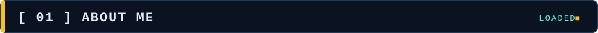
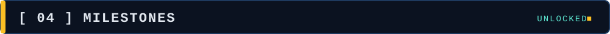
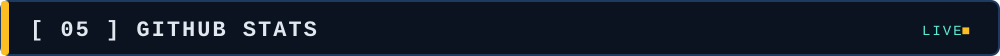

  

 

  

 

Hey, I'm **YOUR NAME**. Write two or three honest sentences here: what you study or do, what you're drawn to, and what you're building right now.

- 🔭 Currently building **PROJECT NAME**
- 🌱 Learning **TOPIC**
- 🤝 Open to **collaborations / internships / freelance**

 

  

 

| Project | What it is | Built with |
| :-- | :-- | :-- |
| [**Project One**](https://github.com/USERNAME/REPO-ONE) | One sentence: the problem it solves and for whom. | `Python` `FastAPI` |
| [**Project Two**](https://github.com/USERNAME/REPO-TWO) | One sentence about what makes it interesting. | `React` `TypeScript` |
| [**Project Three**](https://github.com/USERNAME/REPO-THREE) | Keep each description to a single line. | `Kotlin` |

 

- 🏆 **Your biggest win** — event, year, what you built
- 🥈 **Second win** — event, year
- 📜 **Certification or course** — issuer, year

 

  
  

 

